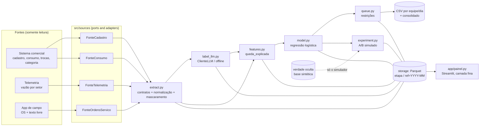

# Arquitetura

## Componentes e fontes

## Fluxo de dados

| Etapa | Entrada (contrato) | Saída (contrato) | Partição |
|---|---|---|---|
| extração | `cadastro_ligacao`, `consumo_mensal`, `troca_hidrometro`, `historico_categoria`, `vazao_setor`, `ordem_servico` | `ordem_servico_normalizada` (sem PII) + tabelas validadas | `ref=YYYY-MM` |
| rotulagem | `ordem_servico_normalizada` | `rotulo_visita` | `ref=YYYY-MM` |
| features | consumo, cadastro, rótulos | `features_ligacao` (+ `features_treino`) | `ref=YYYY-MM` |
| modelo | `features_ligacao`, `features_treino` | `score_ligacao` | `ref=YYYY-MM/variante=<formulação>` |
| fila | `score_ligacao`, `cadastro` | `fila_visita` + CSVs | `ref=YYYY-MM/variante=<formulação>` |
| experimento | score, features, verdade oculta | relatório A/B (JSON) | `ref_formulação` |

Toda etapa: valida contrato na entrada e na saída, grava pendência em vez de descartar, registra `run_id` e contagens no manifesto (`data/lake/_docs/execucoes/<run_id>.json`).

## Pontos de extensão para escala

| Ponto | Hoje | Amanhã | O que muda |
|---|---|---|---|
| Fontes | adapters de arquivo (Parquet) | SQL do comercial, API do app de campo, data lake | classe nova com a mesma interface + linha em `src/sources/registro.py` + `tipo` no `config.yaml` |
| Armazenamento | `ArmazenamentoLocalParquet` | S3/GCS, data warehouse | classe nova com os mesmos métodos de `Armazenamento` |
| Orquestração | `src/pipeline.py` (CLI) | Airflow, Prefect, Step Functions | uma task por entrada de `ETAPAS`; cada uma já é idempotente por partição |
| Processamento | pandas em uma máquina (500 mil ligações em ~40 s) | Spark/DuckDB/Polars se passar de dezenas de milhões de linhas de consumo | `features.py` e `extract.py` são os únicos que tocam o volume grande |
| LLM | regras offline ou Anthropic | outro fornecedor | classe nova com `rotular(prompt) -> RotuloVisita` |
| Contratos | `src/contracts/` | Great Expectations, schema registry | os contratos já são dados: dá para exportar |

## Idempotência e identidade

- Reexecutar o mesmo mês **substitui** a partição (não duplica).
- `run_id` identifica a execução e fica no manifesto e na coluna `run_id` das pendências.
- O cache de rótulos é por `hash(anotação mascarada + versão do prompt + modelo)`.
